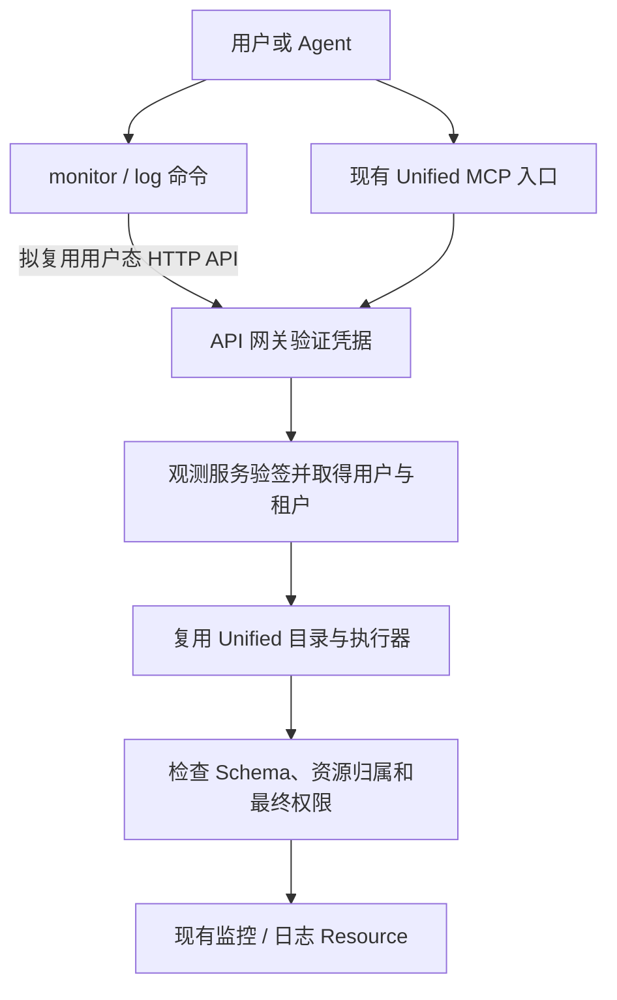

# monitor 用户态 CLI 设计草案

状态：**Go/Cobra 实现与本地回归已完成；尚未发布。** 2026-10-15。

当前命令形态参考 `devops`：

```text
bk-cli monitor <module> <tool_name>
```

- 11 个模块对应 Unified MCP 分类：`space`、`metric`、`log`、`alert`、`event`、`apm`、`dashboard`、`relation`、`alarm`、`collect`、`extract`。
- `tools` 负责 Tool Search 和单工具契约；`permission list/check/apply` 负责权限状态、预检和申请链接。
- `--profile NAME` 引用 SRE 维护的 YAML：绑定既有 context、业务和资源；不保存凭据、不创建环境、不修改全局默认 context。
- `profile list/show` 离线读取配置；`profile check` 检查权限和资源元数据；`status` 检查本地配置、真实鉴权、目录版本和可选的官方版本更新。
- action 与 flag 保留 Unified MCP 原名；只暴露经过审查的 65 个只读工具。
- 不再保留单独的 `log` system；日志命令为 `bk-cli monitor log ...`。

使用方式见 [monitor Skill](../../skills/bk-cli-monitor/SKILL.md) 和 [时间输入](../../skills/bk-cli-monitor/references/time-inputs.md)。真实环境配置、凭据和验收记录由环境维护者独立保管，不随源码分发。

Profile 的当前格式、覆盖语义与 SRE 交付流程见 [Profile 使用与交付](../../skills/bk-cli-monitor/references/profiles.md)。仓内示例与回归使用虚构业务和资源，不代表真实部署。

以下章节保留初始评估与方案对比；其中候选命令和分期不代表当前命令树，使用方式以本节、Skill 与实现为准。

## 1. 先确定主线

**把现有观测 MCP 的用户态能力做成 CLI，而不是另做一个应用态 Unify Query 客户端。**

用户选择蓝鲸环境，使用自己的凭据，然后查询有权限的业务与资源。CLI 负责把易用的参数转换成现有工具请求；工具契约、资源归属、业务权限和执行仍由服务端负责。

| 保持不变 | CLI 增加什么 |
|---|---|
| 现有 MCP 工具名、Schema、前置步骤和风险规则 | 面向用户任务的命令与参数 |
| 认证服务确认用户，网关传递签名身份 | 安全保存、选择和发送用户凭据 |
| 监控/日志服务做最终权限与资源检查 | 清楚的错误、有限结果和下一步提示 |
| bkai-cli 的 MCP/Skill、Agent、模型与知识库职责 | 一个可由 Agent 或人调用的业务 CLI 入口 |

不要求用户申请平台应用 Secret。不要求用户手工维护 `monitor.json` 中的 UQ 表、namespace 或资源映射。不把表名、业务 ID 或本地配置当成权限证明。

旧用户 access_token 仍可能包含应用身份；“用户态体验”不表示应用准入从系统中消失。需要的应用准入由平台侧确认，不把平台 Secret 下发给普通用户。

## 2. PR #23 只作工程参考

初始评估参考过 [PR #23](https://github.com/TencentBlueKing/bk-cli/pull/23) 的提交 `731106517eb597a31a9674af21fc1c21cf8f0b40`。以下仅记录该提交的工程对比，不声明 PR 的当前状态；本 fork 独立推进，不以其合入或协调结果为前置条件。

它实现了 `monitor logs / trace / metrics / query / envs / status`，主要走 UQ 应用态查询。其 `config.go` 使用 `AppVerifiedRequired=true`、`ResourcePermissionRequired=true`，没有要求用户认证；这与我们要复用的 MCP 用户态契约不同。

| 可以参考 | 不作为本方案依赖 |
|---|---|
| Cobra 命令组织、参数帮助、dry-run | `bk-unify-query` 作为产品查询入口 |
| 复用 context、credential、requestexec | `monitor.json` 资源配置与第二套项目环境 |
| 查询失败返回非零、保留部分结果的思路 | UQ 特定返回结构和错误判断代码 |
| mock 测试、集成用例、使用 Skill | 整个 PR、它的共享数字解析改动或代理路径假设 |

本地已在隔离 worktree 编译 PR 原版，`cmd/system/monitor`、`cmd/system`、`internal/api` 三个测试包通过。**这只证明参考代码在本地的相关检查，不代表我们的用户态设计已实现或已验收。** 不继续其业务查询体验。

本 fork 仅注册一个 `monitor` system，不引入参考 PR 的实现。只有未来准备向上游回贡献时，才需重新检查官方主线的注册入口与命令兼容性。

## 3. 请求与鉴权链路

下面是目标结构，不代表 bkauth 在原始 HTTP 入口已经联调通过。



图 1：两种入口复用服务端能力。CLI 不生成可信用户名、不调用 IAM 代替服务端授权，也不直连数据存储。

### 3.1 优先复用 Unified 的 HTTP 门面

建议所有新业务动作最终映射到现有工具，优先使用这些固定入口：

- `lookup_metadata`：按用户提供的空间名称取得真实业务/空间 ID。
- `lookup_tool`：仅在不知道工具时按领域、能力发现，不默认下载全量目录。
- `lookup_tool_schema`：读取一个工具的参数、前置步骤、风险和权限说明。
- `execute_tool`：执行命令固定映射的工具，服务端重验参数与权限。
- `lookup_permissions`：用户问权限、使用 `--plan` 或请求被拒时，按明确业务/工具诊断；不作为每次读取的全量前置步骤。

### 3.1.1 Tool Search 判定规则

CLI 应消费 Unified 的判定，不自行复制权限规则：

| 服务端结果 | CLI 含义 | 下一步 |
|---|---|---|
| `granted` / 预检通过 | `ready` | 执行工具；服务端仍重新鉴权 |
| `requires_resource` | `needs_resource` | 按契约前置工具取得真实资源 ID |
| `missing` | `permission_missing` | 展示 MCP 与 SaaS 二选一权限，不自动申请 |
| 资源不可见 / 不存在 | `resource_not_visible` / `resource_not_found` | 重新从目录选择 |
| 元数据不完整 | `resource_blocked` | 修复服务端资源契约，不引导申请权限 |

权限探测只提交该工具权限模型声明的资源字段，不发送查询语句。IAM、网络或未知错误必须失败关闭，不能改写成“缺资源”或“无权”。

使用外部网关路径 `/mcp/.../`，不把内部 `/api/v4/...` 当成公共地址。

首版业务命令只允许映射到经过评审的只读工具。**不先暴露可以任意填写 tool_name 的万能执行命令。** 只读命令也不能证明整个用户账号只能读取；如果产品需要硬性的只读凭据或服务端白名单，必须在认证/服务端实现。

### 3.2 两种凭据，不混成一种

| 凭据 | 获取与发送 | 当前依据 / 待处理 |
|---|---|---|
| 旧用户 access_token | 用户登录现有门户；CLI 发送 `X-Bkapi-Authorization` | 复用公共 `auth/context`；身份材料和可执行范围按目标网关契约确认 |
| bkauth 个人 Token / OAuth | 用户在 bkauth 创建 Token 或完成浏览器授权；按其正式协议发送 | MCP 已有相应路径；bk-cli 的凭据类型、Bearer 脱敏及目标原始 API 接受范围仍需确认 |

登录属于 bk-cli 公共 `auth/context` 能力，不在 monitor 和 log 下各造一套登录。bkauth 的 realm（认证域）、audience/resource（目标服务）、scope（授权范围）、租户、有效期与撤销规则都要确认。

不能把 `bkp_` Token 塞进旧 `--access_token` 就声称支持 bkauth；也不能依靠 Token 前缀或未验证的 JWT 解码结果确认用户。

### 3.3 “按 MCP 路子”不等于必须新增 MCP Client

本方案首先复用的是 **MCP 的业务与用户态契约**。原始 HTTP 已有旧 Token 的只读验证证据，先把它作为候选传输路径。

如果 bkauth 的现有授权只覆盖 MCP 代理，而原始 API 不接受同一授权，则需要与网关方选择：支持对应用户态 API，或让 CLI 正式调用 MCP 协议。后者属于单独的传输与依赖决策；本次不直接引入 MCP SDK，也不通过伪造 `X-Bkapi-Mcp-Server-Name` 来兼容。

### 3.4 服务端必须保留的边界

- 网关认证与后端验签后才建立用户和租户。CLI 不提交可替换身份的 `bk_username`、`skip_check` 等内部字段。
- 服务端继续检查工具、实际资源和业务权限；权限探测不代表授权。
- 日志的“查询业务”和“索引集归属空间”可能不同。CLI 不自行要求它们相等，也不自行扩大可见范围；按服务端当前规则检查可见性、真实归属与 IAM 资源。
- 不能假设所有环境都启用了同一种 MCP/SaaS 权限复用模式；需要读取当前环境契约并做真实验收，不改动态开关来配合 CLI。

## 4. 先设计两条完整的只读路径

建议首批围绕“找到资源，再查询”，不一次覆盖所有 MCP 能力。以下是候选能力，不是已确定的发版范围。

| 用户要做什么 | 现有工具 / 门面 | 主要输入 | 结果与下一步 |
|---|---|---|---|
| 找到业务/空间 | `lookup_metadata`，`metadata_type=spaces` | 用户提供的名称关键词 | 真实 ID；多条匹配时让用户选择，不取第一条冒充目标 |
| 查看自定义指标分组 | `list_time_series_groups` | 业务 ID、页码、页大小 | 结果表 ID；用于下一步，不是全部平台指标目录 |
| 查看组内指标 | `list_time_series_metrics` | 业务 ID、上一步的 table_id | 字段与维度，帮助构造 PromQL |
| 查询指标 | `execute_range_query` | 业务 ID、PromQL、时间范围、步长 | 时间序列；检查限制与完整性 |
| 找到日志索引集 | `list_index_sets` | 业务 ID | 可用索引集，不把 index_set_id 当作 UQ table_id |
| 查看日志字段 | `get_index_set_fields` | 业务 ID、索引集 ID | 字段与类型，帮助构造查询 |
| 检索日志 | `search_logs` | 索引集、查询、时间窗、条数、字段 | 日志记录及原始定位字段 |
| 查看相邻日志 | `search_index_set_context` | 上一步记录中的定位信息 | 前后文；区分单侧条数与总返回条数 |

字段与前置步骤依据：[指标 OpenAPI](https://github.com/TencentBlueKing/bk-monitor/blob/e63b4fa69/bkmonitor/support-files/apigw/resources/internal/user/metrics_mcp.yaml)、[日志 OpenAPI](https://github.com/TencentBlueKing/bk-monitor/blob/e63b4fa69/bkmonitor/support-files/apigw/resources/internal/user/log_mcp.yaml)、[Unified 门面](https://github.com/TencentBlueKing/bk-monitor/blob/e63b4fa69/bkmonitor/support-files/apigw/resources/internal/user/unified_mcp.yaml)。

首批建议先验证日志的“索引集 → 字段 → 检索”一条路径，再增加指标与上下文。告警、事件、Trace、仪表盘、采集配置、导出暂列后续，不继承 PR #23 的范围。

### 4.1 命令路径仍是草案

正式命令形态尚未确认。独立 demo 暂用分组方式体验，不据此注册正式接口或作兼容性承诺；以下仍保留两种讨论候选：

| 能力 | 扁平动作候选 | 一层分组候选 |
|---|---|---|
| 空间发现 | `monitor search_spaces` | `monitor space list` |
| 指标分组 | `monitor list_metric_groups` | `monitor metric groups` |
| 指标字段 | `monitor list_metrics` | `monitor metric fields` |
| 指标查询 | `monitor query_metrics` | `monitor metric query` |
| 索引集发现 | `log list_index_sets` | `log index list` |
| 日志字段 | `log get_fields` | `log index fields` |
| 日志检索 | `log search` | `log search` |
| 日志上下文 | `log context` | `log context` |

这些名字只保留初始粒度讨论，不是兼容性承诺。正式实现采用本页开头的 `monitor <module> <tool_name>`，分组只使用一层，不创建 `system/subsystem/sub_subsystem/action`。

### 4.2 参数和默认行为建议

- 人常用的输入用命名参数：业务、索引集、查询语句、时间、条数。高级 JSON 输入不是首要体验，不要求用户手写 Unified 外壳。
- `--context` 表示蓝鲸部署，不新增第二套项目 `--env`。业务 ID 可显式给出或从 SRE Profile 补齐；Profile 引用既有 context，并拒绝环境/业务冲突。
- 不知道 ID 时查询服务端目录；用户提供已知真实 ID 时仍由服务端验证。Agent 不猜 ID，不做跨环境默认回退。
- 日志检索建议默认最近 15 分钟、20 条、手动翻页；具体上限按线上 Schema 和响应预算制定。不默认查 24 小时或自动翻到结束。
- 用户明确时间优先；未提供时从当前时钟计算。范围查询不超过现有 24 小时限制，超出先提示，不悄悄拆成大量请求。
- 保留字段真实类型：索引集 ID 为整数；部分业务 ID、页码、时间戳为字符串。序列化以目标 Unified Schema 为准，不把所有数字统一转 float64 或字符串。
- 上下文必须使用检索返回的 `dtEventTimeStamp`、`serverIp`、`gseIndex` 等原值，不以容器 ID 或当前时间替代。`size` 是单侧数量，初始双侧窗口可能返回最多 `2*size`。
- 无分页的底层目录，不伪造服务端分页。CLI 限制展示不等于减少后端响应；超过预算应清楚报错，分页能力另行补齐。

## 5. 客户端只做适配，不复制业务实现

建议新增命令固定映射工具名，把友好参数转换成 `tool_args`，然后通过现有公共请求层发送。完整 Schema、权限动作、资源归属规则和查询实现继续留在 bk-monitor。

只为本次需要的动作编写薄适配，不先建动态 CLI 生成框架、通用 RPC 代理或第二套鉴权 SDK。Go 适合需要时间解析和请求体合成的命令；选择 Go 不能用来绕开 YAML 的认证契约冲突。

主线已合并 `--body @file` / `--body -` 支持（#19）。以后需要高级 JSON 输入时，应复用公共能力并遵守 override 规则，不照搬 #23 的另一套 `--input` 解析器，也不再造第三套文件读取逻辑。

### 输出规则

- 保留 bk-cli 的外层 JSON envelope、HTTP 状态与请求 ID，供脚本和排障使用。
- 分别检查网关结果、Unified 执行状态和具体工具业务结果；不能直接套用 #23 的 UQ 响应解析器。
- HTTP 失败、业务失败、参数失败和部分结果清楚区分；空列表只表示本次成功查询没有匹配结果。
- 为大结果设置明确预算。达到上限报错或返回有来源依据的完整性标记，不输出残缺 JSON，不把截断当成功，也不自动导出数据文件。
- dry-run 只预览，不发请求、不远端检查权限。Token 和认证头不得进入 dry-run、verbose 或异常输出。用户名仅在明确的身份查询或必要审计中展示，不构成客户端可指定的可信身份。业务日志按平台权限和现有脱敏规则处理，CLI 不宣称能识别所有敏感字段。

## 6. 设计确认后，再做最小本地原型

1. **先确认本文的业务与鉴权边界。** 不以参考 PR 是否合并为必要条件。
2. **再定命令路径与最小动作集。** 建议先“索引集 → 字段 → 检索”，共三个动作；空间发现按是否已知业务 ID 配合使用。
3. **只用本地 mock 做体验。** 验证帮助、参数转换、错误、空结果、输出上限、脱敏和 dry-run，不使用真实凭据或业务数据。
4. **再选一个明确业务做只读联调。** 复用自己的用户凭据，比较 CLI/MCP 的身份、权限与审计。不全量枚举权限；不修改业务配置。

当前实现已迁入 Go/Cobra，采用 `bk-cli monitor <module> <tool_name>`。源码内回归使用 mock 服务和虚构资源；真实环境验收需由部署维护者记录具体版本、权限、资源与结果，不能把本地测试通过当作目标环境已上线。

## 7. 实现前需要解决的具体事项

| 事项 | 为什么不能略过 |
|---|---|
| `authConfig` 有效语义 | 现有源定义为 user=true、app=false、resourcePermission=true，bk-cli YAML loader 不接受该组合。需要对齐有效网关契约，不能随意改权限字段 |
| 可信 CLI 身份入口 | 原始 HTTP 不天然带 MCP Server 来源头；要保证它进入正确的用户、租户、最终鉴权和审计路径 |
| bkauth 传输契约 | MCP 能授权不代表原始 API 已接受相同 Token，需要确认目标服务与授权范围 |
| 公共凭据与脱敏 | 现有 Bearer dry-run 缺口、Token 类型和在线校验由公共层处理，不在 monitor/log 中各修一遍 |
| 失败与大响应处理 | HTTP 403 退出 0、全量权限输出超 16 MiB 已有本地证据；新用户流程不能继承这些误判 |
| `monitor` 命名空间 | 本 fork 独立注册；未来向官方回贡献时再核对上游命令冲突，不作为当前开发和试用的阻塞项 |

涉及公共契约的修改，按仓库要求单独 proposal/PR。此草案不授权创建远端 issue、申请权限、修改认证配置、提交或发布。

## 8. 依据与验证口径

- bk-cli 实现起始基线：`master@6baf076a3df7980db0320cca54e8ee471171e58e`。
- PR #23：仅参考指定 head 的 `cmd/system/monitor/spec.go`、`config.go`、`commands.go`、`docs/monitor.md` 和测试组织；它不是本方案的后端/认证真相源。
- bk-monitor 基线：`e63b4fa69`。真相源为 `bkmonitor/support-files/apigw/resources/internal/user/{unified,metrics,log}_mcp.yaml`、`kernel_api/unified_mcp/registry.py`、`permissions.py`、`resource/unified_mcp.py` 和认证中间件。
- 验证边界：仓内 mock 覆盖权限拒绝、资源缺失等情况；bkauth 原始 API 路径、另一用户、跨租户和服务端审计一致性需要独立环境验收，不能从本地测试推断。
- 权限设计需考虑关联空间日志索引集、不同部署的开关差异及服务端最终鉴权；不能复制固定目录数量或假定所有环境具有相同的鉴权顺序。

表达按读者任务组织：先看路线，再看能力映射和待决策；图只说明信任链。没有把“命令长什么样”“本地 mock 跑通”和“真实用户权限已验收”当成同一件事。
